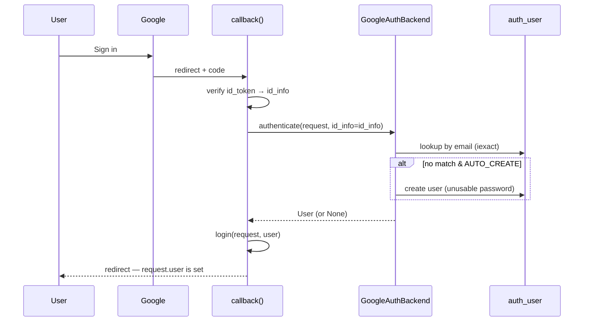

# Django User Integration :material-account-check:

!!! abstract "TL;DR"
    By default Django Gauth is **session-only** — it never touches Django's `User`
    model, so there are **no models and no migrations**. Flip on
    `GOOGLE_USER_INTEGRATION` and a successful Google sign-in *also* opens a real Django
    auth session: `request.user` becomes the signed-in user, `@login_required` and
    `LoginRequiredMixin` work, and the **admin** recognises them — all by mapping onto
    your **existing** `AUTH_USER_MODEL`. Still **zero `django-gauth` migrations**.

---

## Two modes, one flow :material-source-branch:

Django Gauth deliberately ships **off** this feature so the lightweight, model-free story
stays the default:

| | Session-only (default) | User Integration (`GOOGLE_USER_INTEGRATION = True`) |
|---|---|---|
| `request.user` | `AnonymousUser` | the Google-authenticated `User` |
| `@login_required` / `LoginRequiredMixin` | ✗ | ✓ |
| Django admin login | ✗ | ✓ |
| `django-gauth` models / migrations | none | **still none** |
| Auth check | [`check_gauth_authentication()`](../api/utilities.md#check_gauth_authenticationsession) | `request.user.is_authenticated` |

The magic is that integration **reuses your project's own `auth_user` table** via a
get-or-create — Django Gauth adds no tables of its own.

---

## How it works :material-cog-transfer:

When integration is on, [`callback()`](../api/views.md#callbackrequest) does one extra
step after verifying the Google ID token: it calls Django's `authenticate()` with the
verified `id_info`, and if a user comes back, `login()`.



The identity mapping is done by [`GoogleAuthBackend`](../api/backends.md), which delegates
to [`get_or_create_user_from_id_info()`](../api/utilities.md#get_or_create_user_from_id_infoid_info).
The backend is **passive** — called without an `id_info` it returns `None`, so ordinary
username/password logins fall straight through to `ModelBackend`.

---

## Setup :material-toggle-switch:

Three small edits — a flag, a backend, and (usually already present) the auth app +
middleware.

=== "settings.py"

    ```python
    # 1. Turn it on.
    GOOGLE_USER_INTEGRATION = True

    # 2. Register the backend (keep ModelBackend for password/admin logins).
    AUTHENTICATION_BACKENDS = [
        "django_gauth.backends.GoogleAuthBackend",
        "django.contrib.auth.backends.ModelBackend",
    ]

    # 3. These are Django defaults — make sure they're present.
    INSTALLED_APPS = [
        "django.contrib.auth",
        "django.contrib.contenttypes",
        # ...
        "django_gauth",
    ]
    MIDDLEWARE = [
        "django.contrib.sessions.middleware.SessionMiddleware",
        "django.contrib.auth.middleware.AuthenticationMiddleware",
        # ...
    ]
    ```

=== "verify"

    ```bash
    python manage.py check
    ```

    If integration is on but a piece is missing, you'll get a clear warning
    (`django_gauth.W001`–`W003`) instead of a silent no-op.

!!! success "No migrations for django-gauth"
    You do **not** run `makemigrations django_gauth` — it has no models. Integration maps
    onto the `auth_user` table you already migrate as part of `django.contrib.auth`.

---

## Controlling the mapping :material-tune:

Five [`GOOGLE_USER_*` settings](../configuration/settings.md#django-user-integration-settings)
tune the behaviour:

- **`GOOGLE_USER_REQUIRE_VERIFIED_EMAIL`** (default `True`) — refuse sign-in unless Google
  reports the email as verified. This is your primary anti-hijack guard.
- **`GOOGLE_USER_LOOKUP_FIELD`** (default `"email"`) — which `User` field to match, always
  case-insensitively.
- **`GOOGLE_USER_AUTO_CREATE`** (default `True`) — create a `User` on first sign-in, or
  restrict access to pre-provisioned accounts when `False`.
- **`GOOGLE_USER_MAPPER`** — a dotted path to `(id_info, user, created) -> None` that runs
  on every sign-in, so you can copy claims (roles, staff status, avatar) onto the user.

```python
# settings.py
GOOGLE_USER_MAPPER = "myapp.auth.map_google_user"
```

```python
# myapp/auth.py
def map_google_user(id_info, user, created):
    # Grant staff to your Google Workspace domain; sync the display name.
    if id_info.get("hd") == "mycompany.com":
        user.is_staff = True
    user.first_name = id_info.get("given_name", user.first_name)
```

New users are created with an **unusable password** (`set_unusable_password()`), so the
only way in is Google — there's no password to guess.

---

## Protecting views :material-shield-lock:

With integration on, the stock Django tools just work:

```python
from django.contrib.auth.decorators import login_required

@login_required
def dashboard(request):
    return render(request, "dashboard.html")
```

Django Gauth also ships [`gauth_required` and `GauthRequiredMixin`](../api/decorators.md),
which are **dual-mode**: they use `request.user` when integrated and fall back to the
session check otherwise — so the same guard protects a view whether or not you've enabled
integration, and adds a `response="json"` option for SPA/XHR callers.

```python
from django_gauth import gauth_required

@gauth_required(response="json")   # 401 JSON instead of a redirect
def api_me(request):
    return JsonResponse({"email": request.user.email})
```

---

## Probing state from an SPA :material-radar:

[`session_status()`](../api/views.md#session_statusrequest) gains a top-level `user_id`
when integration is on — **always present**, and non-`null` only when a Django user is
authenticated. It lets a frontend correlate the session with a server-side user without
ever exposing the opaque `sub` claim:

```json
{ "authenticated": true, "user": { "email": "a@b.com" }, "user_id": 42 }
```

```json
{ "authenticated": false, "user": null, "user_id": null }
```

---

## When *not* to enable it :material-hand-back-left:

Keep integration **off** if you want the lightest possible footprint — a pure
session/JWT-style flow with no `User` rows, ideal for a stateless SPA backend or a service
that only needs "is this a valid Google session?". You can always turn it on later; the
switch is additive and your existing session-only code keeps working unchanged.

---

## See also

- [Settings Reference → Django User Integration](../configuration/settings.md#django-user-integration-settings)
- [Backends API → `GoogleAuthBackend`](../api/backends.md)
- [Decorators API → `gauth_required` / `GauthRequiredMixin`](../api/decorators.md)
- [Utilities API → `get_or_create_user_from_id_info()`](../api/utilities.md#get_or_create_user_from_id_infoid_info)
