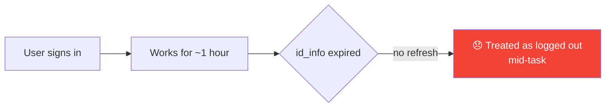
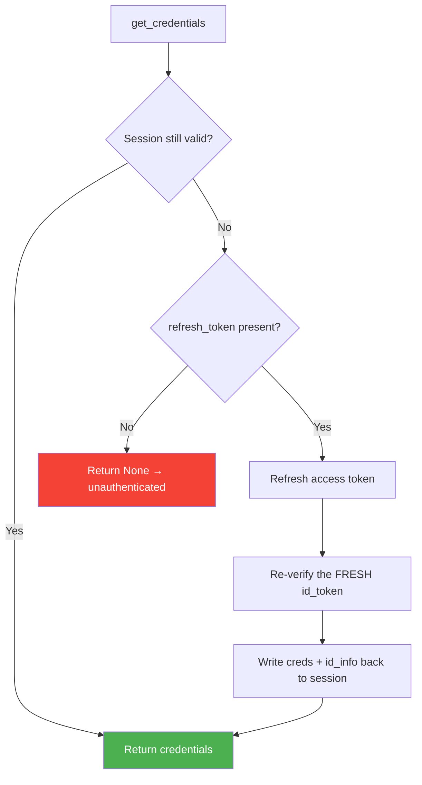
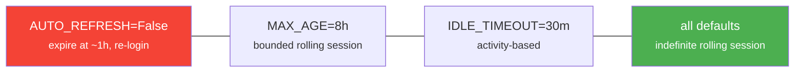
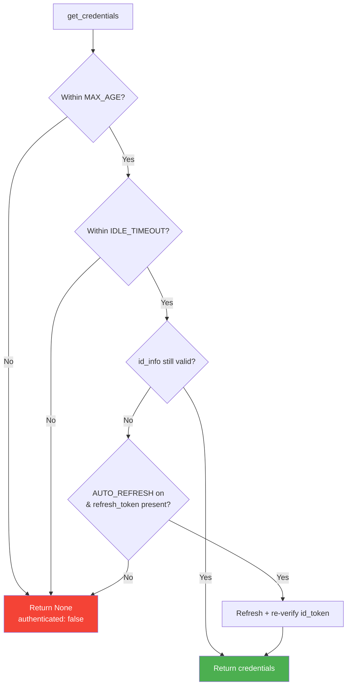
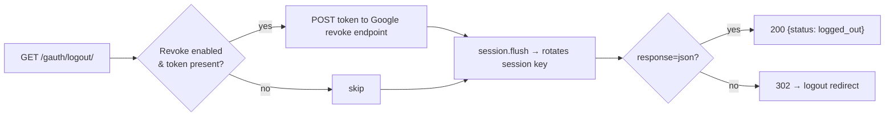
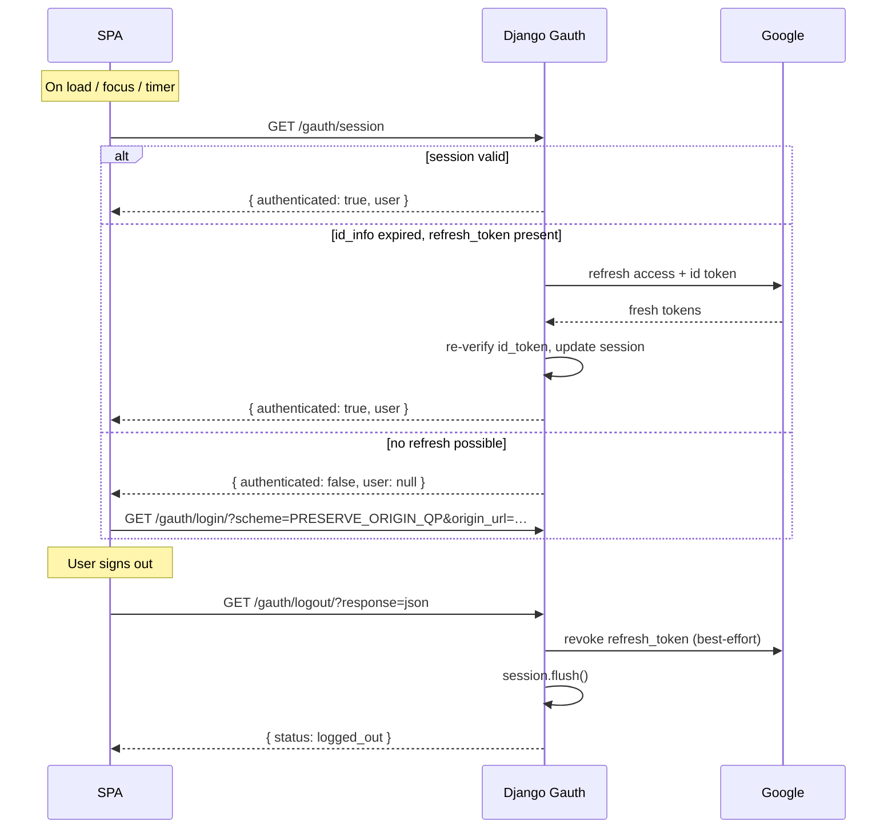

# Session Lifecycle :material-refresh-auto:

!!! abstract "TL;DR"
    A Google **ID token lives only ~1 hour**. Left alone, your users would be
    silently "logged out" every hour — mid-task. Django Gauth **transparently
    refreshes** the access token *and* the cached identity, so sessions survive
    far beyond that window. And when it's time to leave, [`logout()`](../api/views.md#logoutrequest)
    clears the session **and** revokes the token on Google's side — a clean exit,
    out of the box.

---

## The problem: the 1-hour cliff :material-timer-sand:

When a user signs in with Google, Django Gauth stores two things in the session:

- **`credentials`** — the OAuth2 access token, refresh token, and scopes.
- **`id_info`** — the decoded, verified **ID token** claims (email, name, picture,
  and an `exp` expiry).

The ID token's `exp` is typically **one hour** in the future. Django Gauth's
[`check_gauth_authentication()`](../api/utilities.md#check_gauth_authenticationsession)
treats an **expired `id_info`** as "not authenticated" — which is correct for
security, but on its own it means:



The access token, however, comes with a **`refresh_token`** — a long-lived
credential that can mint a **fresh access token *and* a fresh ID token** without
any user interaction. Session lifecycle management puts that refresh token to
work.

---

## The solution: transparent refresh :material-autorenew:

[`get_credentials(request)`](../api/utilities.md#get_credentialsrequest) is the
accessor at the heart of the feature. It returns valid `Credentials` for the
request, and when the session has expired but a `refresh_token` is available it
**silently refreshes** — then writes the refreshed credentials **and** a freshly
re-verified `id_info` back to the session.



!!! success "Why re-verify the ID token, not just the access token?"
    A naïve implementation refreshes only the **access token** — but leaves the
    cached `id_info` (and its `exp`) frozen at the original hour. The very next
    request would see an expired `id_info` and refresh again, forever.

    Django Gauth re-verifies the **fresh `id_token`** returned by the refresh and
    stores the new claims, so the session's clock genuinely **moves forward** with
    each refresh. This is what decouples session lifetime from the 1-hour ID-token
    lifetime.

---

## Choosing a session policy :material-tune-variant:

Transparent refresh is a **default, not a mandate**. A rolling, never-expiring
session is great for a consumer SPA — and exactly wrong for a compliance-bound or
high-value app that must force periodic re-authentication. Django Gauth exposes
three composable knobs so you can sit anywhere on that spectrum:

| Setting | Type | Default | What it does |
|---------|------|---------|--------------|
| [`GOOGLE_SESSION_AUTO_REFRESH`](../configuration/settings.md#google_session_auto_refresh) | `bool` | `True` | Master switch. `False` → **no silent refresh**; the session ends at the ID-token expiry and the user re-logs in. |
| [`GOOGLE_SESSION_MAX_AGE`](../configuration/settings.md#google_session_max_age) | `int \| None` | `None` | **Absolute cap** (seconds). Refuse to extend a session older than `login_time + MAX_AGE`, even with a valid refresh token. |
| [`GOOGLE_SESSION_IDLE_TIMEOUT`](../configuration/settings.md#google_session_idle_timeout) | `int \| None` | `None` | **Idle cap** (seconds). End a session that has been inactive longer than this window. |

The three knobs are **independent and additive** — a session must satisfy *every*
configured cap to be extended:



!!! example "Common policies"
    === "Consumer SPA (default)"

        Keep users signed in as long as Google honours the refresh token.

        ```python
        # nothing to set — these are the defaults
        GOOGLE_SESSION_AUTO_REFRESH = True
        GOOGLE_SESSION_MAX_AGE = None
        GOOGLE_SESSION_IDLE_TIMEOUT = None
        ```

    === "Compliance (hard cap)"

        Force a fresh login at least every 8 hours, and sign out after 30 minutes
        idle — regardless of a valid refresh token.

        ```python
        GOOGLE_SESSION_AUTO_REFRESH = True
        GOOGLE_SESSION_MAX_AGE = 8 * 60 * 60      # 8 hours absolute
        GOOGLE_SESSION_IDLE_TIMEOUT = 30 * 60     # 30 minutes idle
        ```

    === "No silent refresh"

        The session ends when the ID token expires (~1 hour) and the user
        re-authenticates. The strictest option.

        ```python
        GOOGLE_SESSION_AUTO_REFRESH = False
        ```

!!! abstract "How the caps are measured"
    - **Absolute age** is anchored to a login timestamp stamped **once** at
      `callback` time (`gauth_login_at`) and **never** moved on refresh.
    - **Idle** is measured from the last successful `get_credentials()` call
      (`gauth_last_active`), updated on each authenticated access **only when an
      idle timeout is configured** (so there's no extra session write when the
      feature is off).
    - A **legacy session** created before you enabled a cap (and therefore missing
      a stamp) is treated as *within* policy — enabling a cap never abruptly locks
      out already–signed-in users.

!!! note "Where policy is enforced"
    The session policy is enforced by
    [`get_credentials()`](../api/utilities.md#get_credentialsrequest) and therefore
    by the `/gauth/session` probe — the documented, policy-aware source of truth.
    The built-in `/gauth/` landing page performs a lightweight token-presence
    check and is **not** the policy boundary; drive your app's auth state from
    `/gauth/session`.

---

## Precedence: why refresh never beats the caps :material-scale-balance:

!!! question "Is this a bug? I set `AUTO_REFRESH=True` **and** `MAX_AGE`, but hitting `/gauth/session` after the max-age elapses does **not** refresh — it returns `authenticated: false`."
    **No — this is intended behaviour, and it is the whole point of `MAX_AGE`.**
    `GOOGLE_SESSION_AUTO_REFRESH` and `GOOGLE_SESSION_MAX_AGE` answer two
    *different* questions, and the cap deliberately wins.

The three knobs are not variations of one another — they govern **distinct
concerns** and are evaluated in a fixed order. `get_credentials()` checks the
**caps first** and only *then* considers refreshing:



The key insight: **auto-refresh lives *inside* the policy gate, not around it.**
A refresh can only ever extend a session that is **already within** every
configured cap. If `MAX_AGE` (or `IDLE_TIMEOUT`) has elapsed, the gate short-
circuits to "unauthenticated" *before* the refresh branch is ever reached.

!!! danger "If refresh *could* override `MAX_AGE`, the cap would be meaningless"
    A valid `refresh_token` typically lasts for **months**. If a refresh were
    allowed to push a session past `login_time + MAX_AGE`, the very next probe
    would refresh again, and the next, and the next — **forever**. The "force a
    full re-authentication at least every N seconds" guarantee would silently
    never fire. So the cap, by design, is measured from the **original login**
    (`gauth_login_at`, never moved on refresh) and is **not** refreshable.

### The three settings at a glance :material-table-eye:

| | `GOOGLE_SESSION_AUTO_REFRESH` | `GOOGLE_SESSION_MAX_AGE` | `GOOGLE_SESSION_IDLE_TIMEOUT` |
|---|---|---|---|
| **Question it answers** | *"When my access token expires, may I mint a new one silently?"* | *"What is the hard ceiling on total session lifetime?"* | *"How long may the session sit unused before it ends?"* |
| **Type / default** | `bool` · `True` | `int \| None` · `None` | `int \| None` · `None` |
| **Measured from** | n/a (it's a switch) | **Original login** — `gauth_login_at`, stamped once at `callback` | **Last activity** — `gauth_last_active`, updated on each authenticated access |
| **Moves forward over time?** | n/a | ❌ **Fixed** — never moves | ✅ **Sliding** — resets on every access |
| **Can a refresh extend past it?** | — | ❌ **No** (hard cap) | ❌ No, but activity keeps resetting the window |
| **What "expiry" means here** | Access token expired → mint a fresh one (if on) | Absolute deadline reached → **must re-login** | Inactivity window exceeded → **must re-login** |
| **Primary purpose** | Convenience — survive Google's ~1 h token cliff | Security — bounded maximum session | Security — reap abandoned sessions |
| **Typical value** | `True` | `None`, or e.g. `8 * 60 * 60` | `None`, or e.g. `30 * 60` |

### What to expect — and what not to :material-check-decagram:

!!! success "What **to** expect"
    - **`AUTO_REFRESH=True` alone** → an indefinitely rolling session; the ~1 h
      Google token cliff is invisible to your users.
    - **`AUTO_REFRESH=True` + `IDLE_TIMEOUT=30m`** → the session rolls forward
      *as long as the user stays active*, and ends 30 min after they walk away.
      This is the setting that "extends on use".
    - **`AUTO_REFRESH=True` + `MAX_AGE=8h`** → the session is refreshed silently
      up to **8 hours after the original login**, then requires a fresh `/login`
      — no matter how active the user is.
    - **Reaching `MAX_AGE` / `IDLE_TIMEOUT`** → `/gauth/session` returns
      `authenticated: false`, `@gauth_required` blocks, and the landing page shows
      an *"expired"* state naming the governing policy. Recovery is a normal
      `/gauth/login/`.

!!! failure "What **not** to expect"
    - ❌ **`MAX_AGE` will *not* be extended by `AUTO_REFRESH`.** The cap is a hard
      ceiling anchored to the original login; a valid refresh token does not lift
      it. Hitting `/gauth/session` after the cap does **not** revive the session.
    - ❌ **`MAX_AGE` is *not* a sliding window.** If you want "extend while the
      user is active, up to a limit", pair it with `IDLE_TIMEOUT` — `MAX_AGE`
      itself never moves.
    - ❌ **Re-hitting `/login` mid-request is *not* how you recover.** Once a cap
      expires you must complete the OAuth round-trip again (a full `/gauth/login/`
      → Google → callback). The probe alone cannot resurrect a capped session.

!!! tip "Want a session that can be refreshed indefinitely?"
    Simply **leave `GOOGLE_SESSION_MAX_AGE` unset** (`None`, the default). Then
    only the Google token expiry and any optional `IDLE_TIMEOUT` apply, and
    `AUTO_REFRESH` will keep extending the session for as long as Google honours
    the refresh token.

---

## The `/gauth/session` probe :material-access-point:

For SPA frontends, [`session_status()`](../api/views.md#session_statusrequest)
exposes `get_credentials()` as a tiny JSON endpoint your app can poll — on load,
on focus, or on a timer:

| | |
|-|-|
| **URL** | `GET /gauth/session` |
| **Authenticated** | `{ "authenticated": true, "user": { "email": "...", "name": "...", "picture": "..." } }` |
| **Not authenticated** | `{ "authenticated": false, "user": null }` |

Because the probe runs through `get_credentials()`, **the very act of asking
"am I still logged in?" refreshes the session** when it can. The `user` payload
is the sanitized `id_info` (`iss`/`azp`/`aud`/`sub` stripped), matching the
landing page and debug endpoint.

```js
// A minimal SPA auth check that also keeps the session warm
async function getSession() {
  const res = await fetch("/gauth/session", { credentials: "include" });
  return res.json(); // { authenticated, user }
}

const { authenticated, user } = await getSession();
if (!authenticated) {
  // send the user through the login flow (see Redirection Schemes)
  window.location.href = "/gauth/login/?scheme=PRESERVE_ORIGIN_QP" +
    `&origin_url=${encodeURIComponent(window.location.href)}`;
}
```

!!! tip "Why an accessor + probe, not middleware?"
    Django Gauth deliberately ships an **accessor** (`get_credentials`) and a
    **probe** (`/gauth/session`) rather than request-mutating middleware. An SPA
    is the source of truth for its own navigation, and an explicit probe is
    idiomatic for React/Vue/Angular apps — it keeps refresh behaviour predictable
    and testable, with no hidden global state on every request.

---

## Clean logout — with token revocation :material-logout:

Clearing the local session is only half of a real logout. The
[`logout()`](../api/views.md#logoutrequest) view also **revokes the token on
Google's side** (by default), so the grant is genuinely withdrawn — not just
forgotten locally.



Like `login()`, `logout()` honours the **`?response=`** convention so it plugs
into either a server-rendered app or an SPA:

=== "SPA (json)"

    ```js
    await fetch("/gauth/logout/?response=json", {
      method: "GET",
      credentials: "include",
    });
    // then navigate wherever you like
    window.location.href = "/";
    ```

=== "Server-rendered (redirect)"

    ```html
    <a href="">Sign out</a>
    ```

    Redirects to `GOOGLE_AUTH_LOGOUT_REDIRECT_URL` (or the `/gauth/` index).

!!! info "Revocation is best-effort — logout never fails because of it"
    Django Gauth prefers to revoke the **`refresh_token`** (revoking it also
    invalidates the access tokens derived from it). If the revocation call fails —
    a network blip, an already-revoked token — the error is swallowed and the
    **local session is still cleared** via `session.flush()`. Users are never
    stuck "unable to log out".

    Prefer to keep the Google grant intact and only clear the local session? Set
    `GOOGLE_TOKEN_REVOKE_ON_LOGOUT = False`.

---

## Settings :material-cog:

| Setting | Type | Default | Effect |
|---------|------|---------|--------|
| [`GOOGLE_SESSION_AUTO_REFRESH`](../configuration/settings.md#google_session_auto_refresh) | `bool` | `True` | Master switch for transparent token refresh |
| [`GOOGLE_SESSION_MAX_AGE`](../configuration/settings.md#google_session_max_age) | `int \| None` | `None` | Absolute session cap (seconds) |
| [`GOOGLE_SESSION_IDLE_TIMEOUT`](../configuration/settings.md#google_session_idle_timeout) | `int \| None` | `None` | Idle timeout (seconds) |
| [`GOOGLE_TOKEN_REVOKE_ON_LOGOUT`](../configuration/settings.md#google_token_revoke_on_logout) | `bool` | `True` | Revoke the Google token on logout |
| [`GOOGLE_AUTH_LOGOUT_REDIRECT_URL`](../configuration/settings.md#google_auth_logout_redirect_url) | `str \| None` | `None` | Destination for `?response=redirect` logout (falls back to the index) |

---

## Putting it together — an SPA session pattern



---

## See also

- [Views API → `logout()`](../api/views.md#logoutrequest) and
  [`session_status()`](../api/views.md#session_statusrequest)
- [Utilities API → `get_credentials()`](../api/utilities.md#get_credentialsrequest) and
  [`revoke_google_token()`](../api/utilities.md#revoke_google_tokentoken)
- [Redirection Schemes](redirection-schemes.md) — bring users back to where they started
  after a re-login.
- [Settings Reference](../configuration/settings.md) — the logout settings.
